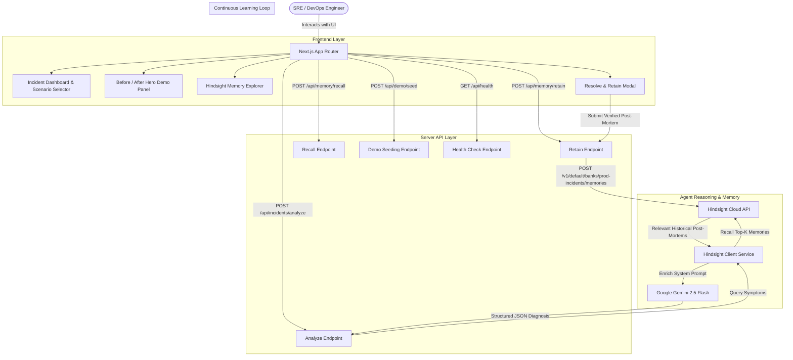
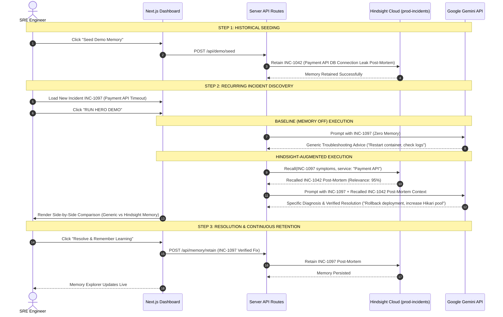

# INCIDENTIQ — ARCHITECTURE SPECIFICATION & MERMAID DIAGRAMS

## 1. System Overview

IncidentIQ is a persistent-memory incident response agent engineered for SRE and DevOps teams. It bridges the gap between raw incident logs and organizational memory by utilizing **Hindsight** (by Vectorize.io) to retain post-mortem learnings and recall verified resolutions during active production outages.

---

## 2. The Persistent Memory Learning Loop

---

## 3. Data Flow & Security Model

1. **Server-Side API Keys**: `GEMINI_API_KEY` and `HINDSIGHT_API_KEY` are read exclusively in Next.js Route Handlers (`app/api/*`). Secrets are never exposed to browser client bundles.
2. **Normalized Memory Format**: All memories retrieved from Hindsight Cloud are normalized into a typed `HindsightMemory` interface (`incidentId`, `service`, `symptoms`, `rootCause`, `resolution`, `relevanceScore`).
3. **Mock Fallback Resilience**: If API keys are unpopulated during local dev, IncidentIQ falls back to an in-memory store while maintaining exact API interfaces and displaying transparent health status badges.
